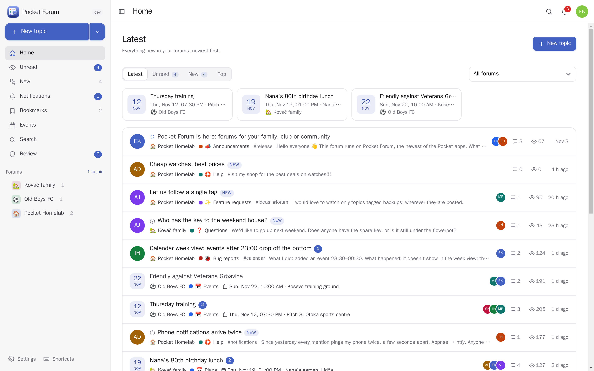
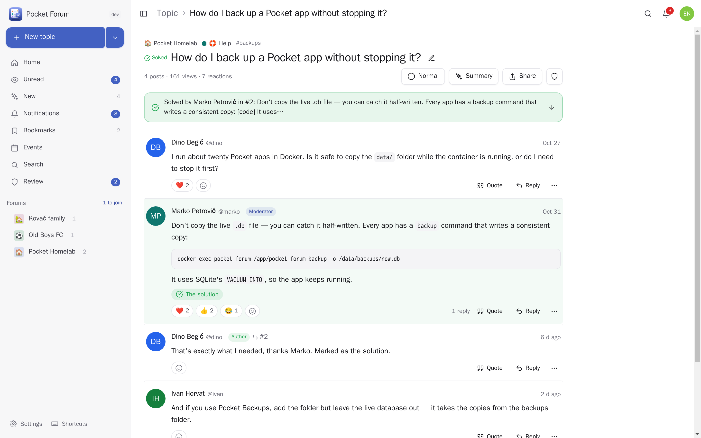
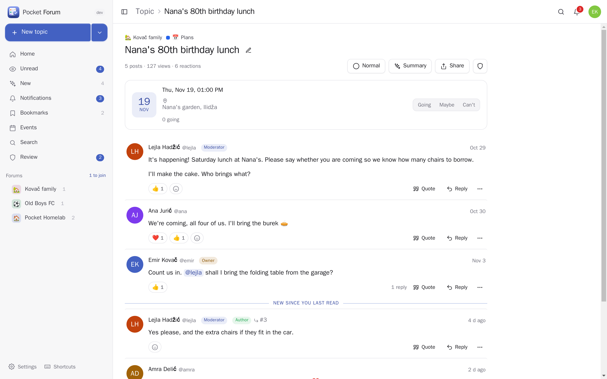
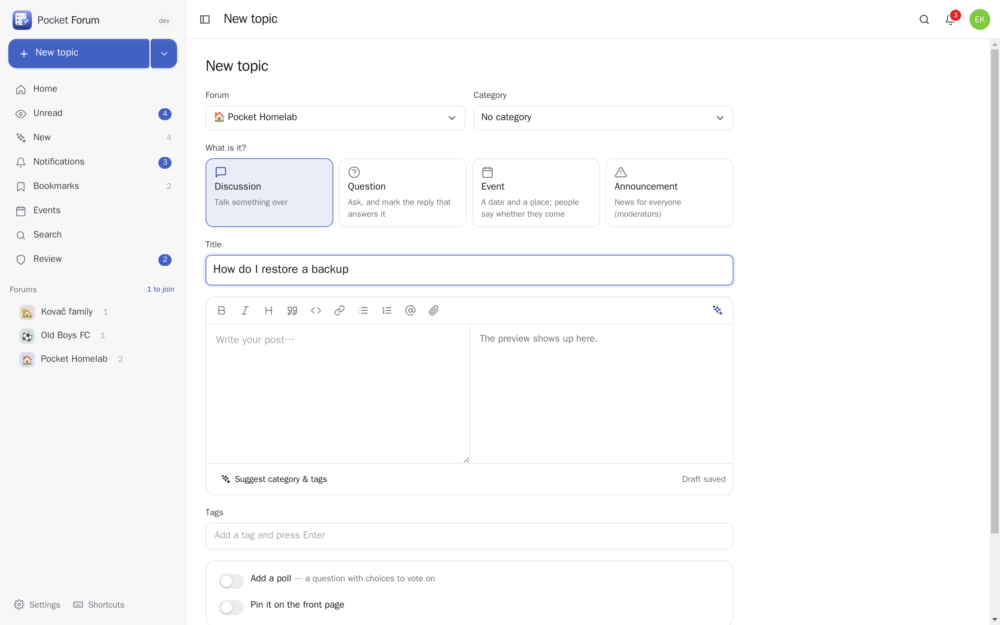
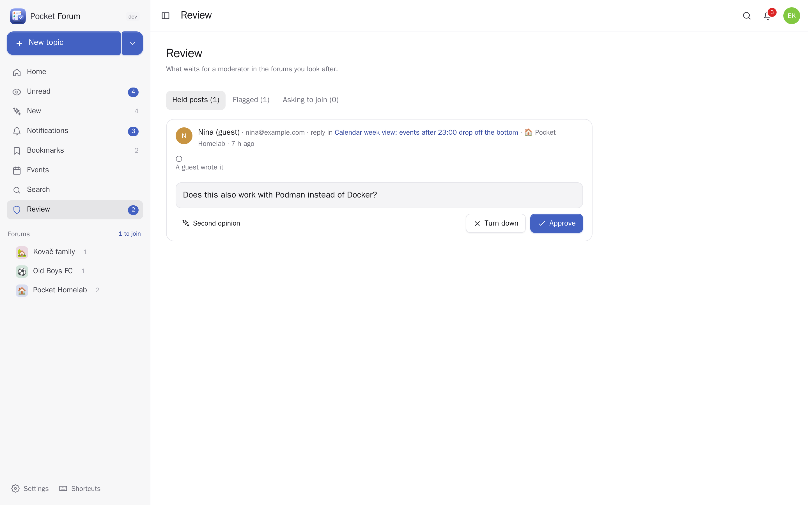
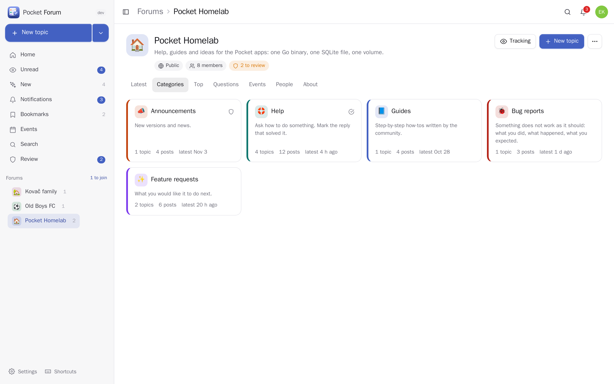
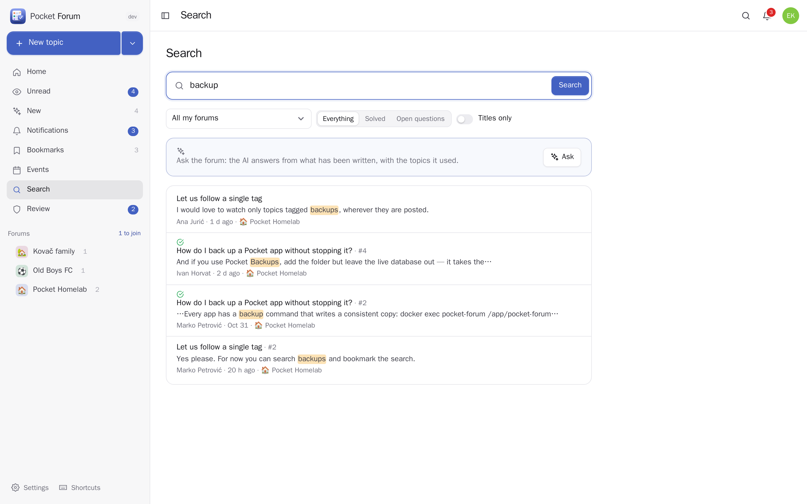
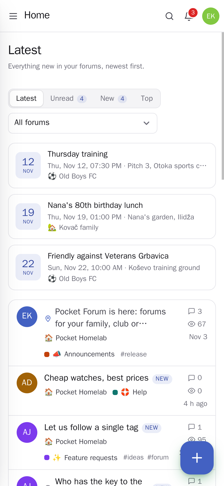
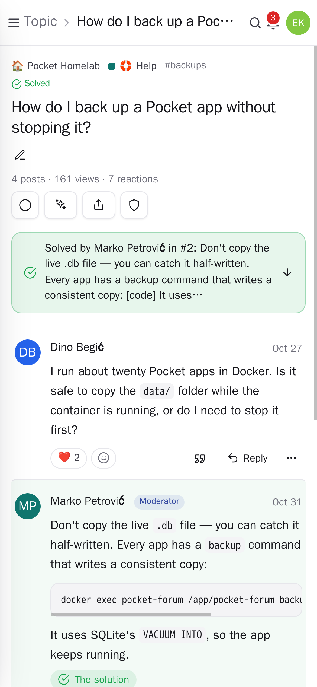
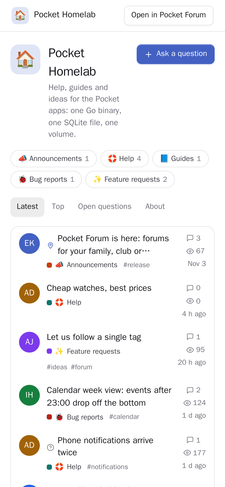

<p align="center"></p>

<h1 align="center">Pocket Forum</h1>

<p align="center">Forums for your family, club, team or community: categories, topics and threaded replies with quotes, @mentions, reactions, pictures and files, polls, events with who is coming, and questions that get an accepted answer. New and unread tracked for you, everything searchable, private or public forums, guest posts held for approval, and a real moderation queue. Replaces Discourse, Flarum or phpBB for the people around you — and brings a Discourse forum over.<br>One Go binary, one SQLite file, one volume. Part of the Pocket apps; works on its own too.</p>

<p align="center">
  <a href="https://github.com/abjelosevic88/pocket-homelab-forum/actions/workflows/ci.yml"></a>
  <a href="https://github.com/abjelosevic88/pocket-homelab-forum/pkgs/container/pocket-homelab-forum"></a>
  <a href="LICENSE"></a>
</p>

<p align="center"></p>

<table>
  <tr>
    <td width="50%"></td>
    <td width="50%"></td>
  </tr>
  <tr>
    <td align="center"><sub>A question with its accepted answer, quotes, code and reactions.</sub></td>
    <td align="center"><sub>An event: say whether you come, add it to your calendar.</sub></td>
  </tr>
  <tr>
    <td width="50%"></td>
    <td width="50%"></td>
  </tr>
  <tr>
    <td align="center"><sub>Starting a topic: similar topics show as you type the title.</sub></td>
    <td align="center"><sub>Review: held posts, flags and join requests, with an AI second opinion.</sub></td>
  </tr>
  <tr>
    <td width="50%"></td>
    <td width="50%"></td>
  </tr>
  <tr>
    <td align="center"><sub>Categories, with questions & answers and moderator-only ones.</sub></td>
    <td align="center"><sub>Search every forum — or ask, and the AI answers from what was written.</sub></td>
  </tr>
</table>

<table>
  <tr>
    <td width="33%"></td>
    <td width="33%"></td>
    <td width="33%"></td>
  </tr>
</table>

## What it does

- **Forums, categories, topics.** As many forums as you like, each with its own people, categories (and subcategories), rules, welcome message, colour and reactions. Start from a template: community, help & support, club or team, family, work team, book club.
- **Four kinds of topic.** Discussions; questions whose asker marks the reply that solved it; events with a date, a place and *Going / Maybe / Can't*; announcements.
- **Writing.** Markdown with a toolbar and a live preview, @mentions with suggestions, quotes of other posts, pictures and files (paste or drop them; pictures are shrunk first), polls, spoilers, drafts kept as you type, ⌘↩ to post, edit history.
- **Reading.** Where you left off, *new* and *unread* in every list, new replies appearing as they are written (the page never jumps under your finger), follow levels for topics, categories and whole forums (watching, tracking, normal, muted), bookmarks with a reminder, a summary of a long topic or of what you missed.
- **Notifications.** A bell with mentions, replies, quotes, reactions, solutions and more; phone pushes through Apprise or ntfy (not while you are reading); a daily or weekly summary email of what you missed.
- **Who sees what.** Private forums (only the people you invite — the box's admins do not see them), forums everyone on this box can find, public forums anyone with the link can read, with an RSS feed. Join freely, by asking, or by invitation; invite links with a QR code, for one person or many, that let people without an account make one.
- **Moderation.** A review queue for held and flagged posts and join requests; hold new members' first posts, watched words, banned words, slow mode, an edit window; pin, close, unlist, archive, close later, move, merge and split topics; hide posts; bans and pauses with an end date; titles and badges; a log of every step.
- **Search.** Full text over every post (accents ignored), filters for forum, category, tag, author, solved or open, titles only; similar topics while you write a title.
- **Bring a forum over.** The categories and newest topics of any public Discourse forum, with every post; again later = only what is new. Export and import of your own forums as JSON (twice changes nothing), and every topic as CSV.

## Run it

```sh
docker run -d --name pocket-forum -p 8080:8080 -v ./data:/data \
  -e BASE_URL=https://forum.example.com -e SECURE_COOKIES=true \
  ghcr.io/abjelosevic88/pocket-homelab-forum:latest
```

Open it and make the first account (that one is the admin). To try it with made-up forums: `DEMO_DATA=true AUTH_MODE=none`. Behind a reverse proxy, let the live updates through (Caddy: `flush_interval -1`). Release binaries for Linux, macOS, Windows and FreeBSD are on the releases page. Settings: [docs/configuration.md](docs/configuration.md), API: [docs/api.md](docs/api.md), backup: [docs/backup.md](docs/backup.md).

## With Pocket Core

Set `CORE_URL` and `CORE_REGISTRATION_KEY` and Forum joins the box: people sign in with Pocket Core, Pocket AI helps, and through app links (each person switches them on) it reaches the other Pocket apps — every one optional, greyed out with what to do when it is not there:

| App | What for | Scopes |
|---|---|---|
| Pocket Chat | share a topic or a post into a chat, as a card with its link | `chat:read`, `chat:write` |
| Pocket Email | invitations and topics from your own mail account; the summary email | `mail:send` |
| Pocket Contacts | pick the people to invite | `contacts:read` |
| Pocket Calendar | an event topic in your calendar | `calendar:write` |
| Pocket Tasks | a post as a task to follow up | `tasks:write` |
| Pocket Projects | a bug report or an idea as an issue for your team | `projects:read`, `projects:write` |
| Pocket Notes | save a topic or its summary; quote one of your notes in a post | `notes:read`, `notes:write` |
| Pocket Files | a whole topic as a Markdown file | `files:write` |
| Pocket Photos | your photos in a post | `photos:read` |
| Pocket Learn | a question and its accepted answer as a flashcard | `learn:read`, `learn:write` |
| Pocket Blog | a topic as a blog post draft, crediting the people in it | `blog:write` |
| Pocket Bookshelf | a book from your shelf in a post (book clubs) | `books:read` |
| Pocket Places | a saved place in a post or an event | `places:read` |
| Pocket Translate | a post in your language (without it, the AI translates) | `translate:run` |

Other apps use your forums through `forum:read` and `forum:write`: Pocket AI answers “what is new in the family forum?” or replies for you when you ask, Pocket Search finds topics, Pocket Day shows what you wrote, Pocket Blog can open a discussion for a post. Pocket AI here summarises topics, drafts and polishes replies, suggests a category and tags, answers questions from the forum with the topics it used, and gives moderators a second opinion — it never posts by itself. Events for Pocket Flows: `forum.topic_created`, `post_created`, `mentioned`, `solved`, `flagged`, `joined`.

## Develop

```sh
make run      # build the web app and the binary, start with demo data on :8080
make dev      # Go server + Vite dev server
make test     # go vet, go test, tsc
```

Go 1.26, `modernc.org/sqlite` (no CGO, FTS5 for search), chi; React 19, TypeScript, Vite.

MIT © 2026 Aleksandar Bjelosevic
